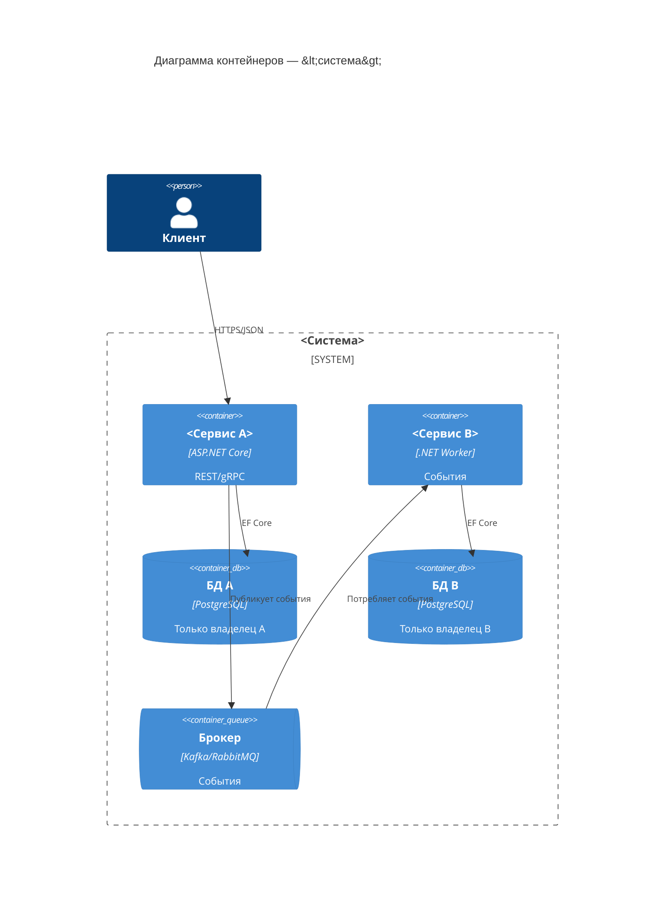

# Границы сервисов (service boundaries)

Определяет, как сервисы разделяются, чем владеют и как взаимодействуют. Согласуется с
[конституцией](../../openspec/constitution.md) (раздел 2).

## Принципы выделения

- Границы проводятся по **bounded context** (DDD), а не по техническим слоям.
- Каждый сервис владеет **своей моделью данных** и **своей БД** (database-per-service).
- Сервис можно независимо развернуть и масштабировать; изменение внутри не требует синхронных изменений соседей.
- Транзакции не пересекают сервисы (согласованность — в конечном счёте, события/outbox).

## Правила владения

| Ресурс | Кто владеет |
| - | - |
| Данные (таблицы/схема) | Ровно один сервис |
| Публичный контракт (HTTP/gRPC/событие) | Сервис-владелец |
| Ключи/секреты | Операционная платформа (vault) |

## Взаимодействие

- **Синхронно** — gRPC (внутренние) / REST (внешние); только через контракты, без доступа к чужой БД.
- **Асинхронно** — события через брокер; доставка at-least-once + идемпотентность (см. [`../../openspec/standards/08-messaging.md`](../../openspec/standards/08-messaging.md)).
- Контракты версионируются; ломающие изменения — только по конституции (раздел 4).

## Диаграмма (обновляйте по мере роста)

## Антипаттерны (запрещено)

- Общая БД/таблица между сервисами.
- Distributed transaction (2PC) между сервисами.
- Синхронный вызов «цепочкой» без таймаутов и деградации.
- Протаскивание внутренних сущностей одного сервиса в контракт другого.
