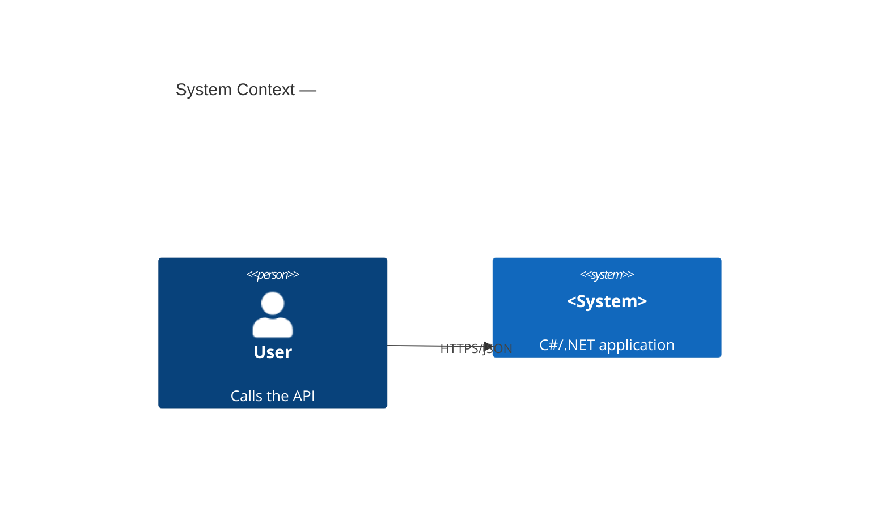

# Project Context

Context for every agent working in this repository. Keep it short, factual, and up to date.

## What this is

An **agentic, Spec-Driven Development** workspace for a **C# / .NET** project. Cline orchestrates
specialized subagents (Architect → Developer → Reviewer) and every change is specified before it is
implemented.

## Tech stack

- **Runtime:** .NET 8+ (SDKs 9 and 10 are installed on the build machine). Pin with `global.json` if needed.
- **Language:** C# 12+, nullable reference types enabled, warnings as errors.
- **Web:** ASP.NET Core (Minimal APIs preferred) + gRPC для внутренних контрактов.
- **Persistence:** EF Core (database-per-service); Dapper для горячих запросов.
- **Messaging:** Kafka/RabbitMQ (+ transactional outbox).
- **Cache:** Redis (распределённый), `IMemoryCache` (локальный).
- **Resilience:** Polly (таймауты, retry с jitter, circuit breaker, bulkhead).
- **Observability:** OpenTelemetry (traces/metrics/logs), health-checks.
- **Tests:** xUnit + FluentAssertions (+ NSubstitute/Moq), Testcontainers для интеграции.
- **Tooling:** `dotnet` CLI for everything.

## Conventions

- Source under `src/`, tests under `tests/` (`<Project>.UnitTests`, `<Project>.IntegrationTests`).
- Domain logic framework-agnostic; API layer handles HTTP concerns only.
- One proposal ≈ one cohesive, reviewable change.

## Architecture (update as it grows)

## Where things live

| Concern | Location |
| - | - |
| Rules for Cline | `.clinerules` |
| Subagent roles | `.agents/*.md` |
| Skills | `.agents/skills/*/SKILL.md` |
| Specs & proposals | `openspec/` |
| Constitution (highest priority) | `openspec/constitution.md` |
| Engineering standards | `openspec/standards/` |
| Architecture & operations docs | `docs/` |
| Config / profile | `openspec/config.yaml` |

## Open decisions

- (add unresolved architectural decisions here, with the chosen default and the reason)
