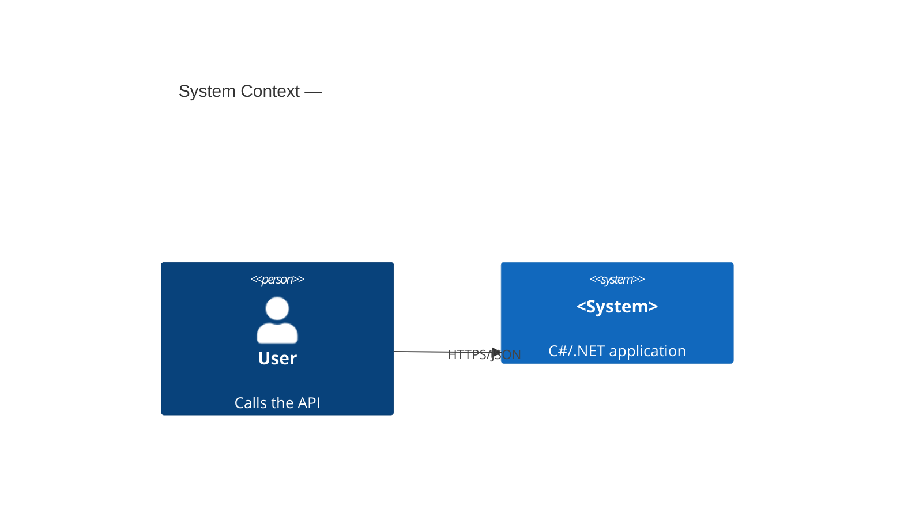

# Project Context

Context for every agent working in this repository. Keep it short, factual, and up to date.

## What this is

An **agentic, Spec-Driven Development** workspace for a **C# / .NET** project. The main **DeepSeek Harness**
session orchestrates role subagents (DSH agent presets: analyst → architect → developer → QA → reviewer →
ops/release) and every change is specified before it is implemented.

## Tech stack

- **Runtime:** .NET 10 (`net10.0`); SDK pinned to `10.0.401` in `global.json`. .NET 8/9 are EOL since 2026-11-10 (D-015).
- **Language:** C# 14, nullable reference types enabled, warnings as errors.
- **Web:** ASP.NET Core (Minimal APIs preferred) + gRPC для внутренних контрактов.
- **Persistence:** EF Core (database-per-service); Dapper для горячих запросов.
- **Messaging:** Kafka/RabbitMQ (+ transactional outbox).
- **Cache:** Redis (распределённый), `IMemoryCache` (локальный).
- **Resilience:** Polly (таймауты, retry с jitter, circuit breaker, bulkhead).
- **Observability:** OpenTelemetry (traces/metrics/logs), health-checks.
- **Tests:** xUnit + FluentAssertions (+ NSubstitute/Moq), Testcontainers для интеграции.
- **Tooling:** `dotnet` CLI for everything.

## Project profile

One project selects **one** active profile in [`openspec/config.yaml`](./config.yaml) (`project.profile`).
Schema, standards and DoD sections follow that selection.

| Profile | For | Schema | Standards | DoD |
| - | - | - | - | - |
| `csharp-api` | server side: ASP.NET Core, microservices, databases, brokers | [`schemas/csharp-api.yaml`](./schemas/csharp-api.yaml) | 01–11 | 5.1–5.7 |
| `csharp-desktop` | desktop product: Avalonia UI, local models, data on the device | [`schemas/csharp-desktop.yaml`](./schemas/csharp-desktop.yaml) | 01–11 + [`12-desktop.md`](./standards/12-desktop.md) | 5.1/5.2/5.5/5.6 + **5.8** |

Switching the active profile is a decision recorded in [`DECISIONS.md`](../DECISIONS.md); a proposal is
validated only against the active profile.

## Conventions

- Source under `src/`, tests under `tests/` (`<Project>.UnitTests`, `<Project>.IntegrationTests`).
- Domain logic framework-agnostic; API layer handles HTTP concerns only.
- One proposal ≈ one cohesive, reviewable change.

## Architecture (update as it grows)

## Where things live

| Concern | Location |
| - | - |
| Rules for agents (DSH canon) | `AGENTS.md` (`.clinerules` is a compatibility mirror) |
| Subagent roles | `.agents/*.md` |
| Skills | `.agents/skills/*/SKILL.md` |
| Specs & proposals | `openspec/` |
| Constitution (highest priority) | `openspec/constitution.md` |
| Engineering standards | `openspec/standards/` |
| Architecture & operations docs | `docs/` |
| Legacy documentation registry | `docs/legacy/` (registry `LEG-NNN`, correspondence map, frozen changelog) |
| Customer input materials | `inputs/` (registry: `inputs/INDEX.md`) |
| Config / profile | `openspec/config.yaml` |

## Open decisions

Unresolved items are tracked in [`OPEN_QUESTIONS.md`](../OPEN_QUESTIONS.md) (questions) and
[`DECISIONS.md`](../DECISIONS.md) (accepted decisions). Keep this file short: stack, conventions, map.
