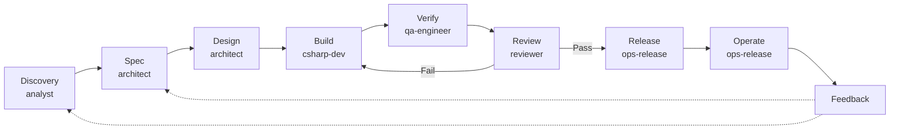
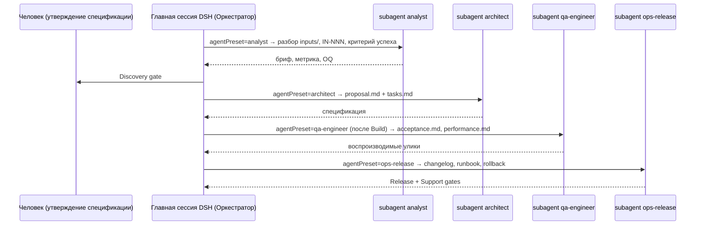

# Design — 002-lifecycle-and-roles

Дизайн каркаса фаз, гейтов и трёх ролей, а также их проводки в рабочую среду **DeepSeek Harness**.
Изменение документарное и конфигурационное: C#-кода не добавляет.

## 1. Два дефекта, которые закрывает предложение

1. **Фазы без владельца.** Артефакты есть (дискавери — `inputs/`, верификация — `acceptance.md`,
   релиз — `CHANGELOG.md` и DoD 5.4, эксплуатация — `docs/operations/`), но ни одна роль за них не
   отвечает, поэтому они выполняются «если вспомнят». Хуже: улики верификации производит автор кода,
   то есть тот, кого проверяют.
2. **Рассинхрон со средой.** Авторитетные документы описывают Cline (`spawn_agent`, Cline CLI), а рабочая
   среда — DSH, где делегирование идёт субагентами с `agentPreset`, а `.clinerules` не читается вовсе.
   Агент получает инструкции про инструмент, которого у него нет.

## 2. Карта фаз: артефакт → гейт → владелец

| Фаза | Артефакт | Гейт (условие блокировки) | Владелец |
| - | - | - | - |
| **Discovery** | `inputs/**` + `INDEX.md` (`IN-NNN`), измеримый критерий успеха | Discovery gate: материал зарегистрирован, критерий измерим, нерешённое ушло в `OQ-N` | Продуктовый аналитик |
| **Spec** | `openspec/proposals/<id>/proposal.md` + дельты `specs/` | Spec gate: утверждение человеком (`Status: Approved`) | Архитектор |
| **Design** | `design.md`, `contracts/`, ADR | ADR обязателен для архитектурного решения | Архитектор |
| **Build** | `src/`, `tests/` | Build + Test gate: `dotnet build/test/format` зелёные | Разработчик |
| **Verify** | `acceptance.md`, `performance.md` | Verification gate: улики воспроизводимы, произведены не автором кода, непроверенное помечено явно | Инженер верификации (QA) |
| **Review** | вердикт ревью | Review gate: `VERDICT: Pass` (двухосевой проход, 001) | Ревьюер |
| **Release** | `CHANGELOG.md`, версия, миграции, rollback | Release gate (DoD 5.4): changelog с `(<ID>)`, SemVer, проверенный откат, runbook | Ops / Release |
| **Operate** | `docs/operations/{slo,capacity,runbooks/}` | Support gate: health/alerts и runbook готовы до включения трафика | Ops / Release |
| **Feedback** | `OQ-N` или новое предложение | Feedback loop: инцидент становится отслеживаемым пунктом | Ops / Release → Аналитик |

## 3. Почему именно три роли и почему не больше

Критерий допуска роли (`R12`): роль владеет **артефактом**, закрывает **гейт** и работает в **своём
контексте**. По этому критерию закрываются три дыры и отклоняются остальные кандидаты.

| Роль | Артефакт | Гейт | Почему отдельная роль |
| - | - | - | - |
| Продуктовый аналитик | `inputs/`, `INDEX.md`, критерий успеха | Discovery | сегодня вход разбирает «кто-нибудь»; обязанность разобрать материалы и назвать измеримый критерий ни на кого не назначена |
| Инженер верификации (QA) | `acceptance.md`, `performance.md`, улики | Verification | снимает конфликт «автор кода доказывает, что его код работает»; Ревьюер остаётся судьёй по соблюдению требований и стандартов, а не добытчиком доказательств |
| Ops / Release | `docs/operations/*`, релизная часть `CHANGELOG.md` | Release, Support | у релиза и эксплуатации общий набор артефактов и один владелец риска; разделять на «Release Manager» и «SRE» пока нечем — вторая роль не получит собственного уникального гейта |

**Отклонённые кандидаты** (фиксируем, чтобы не возвращаться):

- **Оркестратор** — это главная сессия DSH, отдельный агент не нужен (иначе «оркестратор для оркестратора»).
- **Security** — условный проход по классификации риска, а не постоянная роль → `OQ-9`.
- **Маркетинг / Product Owner** — входной материал (`inputs/markets/`), а не роль в кодовом SDD → `OQ-8`.
- **DevOps / CI** — автоматика (workflow, скрипты), у неё нет собственного артефакта-гейта в SDD.
- **Отдельный «тестировщик» и отдельный «документатор»** — обязанности без уникального гейта: тесты
  принадлежат Разработчику (Build gate), документация — владельцу фазы (DoD каждой фазы).

## 4. Среда исполнения: DeepSeek Harness

Роли объявляются пресетами в [`dsh/profile/cordis.patch.yml`](../../../dsh/profile/cordis.patch.yml);
порядок (`order`) отражает последовательность фаз:

| preset `id` | order | Роль | Фаза |
| - | - | - | - |
| `analyst` | 5 | Продуктовый аналитик | Discovery |
| `architect` | 10 | Архитектор | Spec, Design |
| `csharp-dev` | 20 | Разработчик C# | Build |
| `qa-engineer` | 25 | Инженер верификации | Verify |
| `reviewer` | 30 | Ревьюер | Review |
| `ops-release` | 40 | Ops / Release | Release, Operate, Feedback |

Ключевые решения по среде:

- **Персона короткая и ссылается на файл роли** — правила не дублируются (принцип `D-003` п. b–c).
- **Персоны перечисляют файлы явно** (`AGENTS.md`, `openspec/constitution.md`, `openspec/standards/`, файл роли):
  `OQ-1` (читает ли DSH `AGENTS.md` как инструкции воркспейса) остаётся открытым, поэтому явный список
  гарантирует доставку правил делегированному агенту независимо от ответа на этот вопрос.
- **`.clinerules` DSH не читает** (факт из [`dsh/README.md`](../../../dsh/README.md) §«Ограничения», п. 5).
  Канон среды — `AGENTS.md` + `openspec/` + `.agents/*`; `.clinerules` остаётся совместимым зеркалом для
  других инструментов, но теряет Cline-зависимые инструкции.
- **Скиллы не добавляем.** Роли на первом шаге самодостаточны; скилл появляется, когда процедура
  повторяется (принцип «один шов — гипотеза, два — реальность»). Это осознанное ограничение объёма.

## 5. Компромиссы и риски

| Риск | Как проявится | Митигация |
| - | - | - |
| «Гейт-театр»: гейт есть, артефакта нет | гейт превращается в пункт, который все пропускают | `R2`: гейт без подтверждающего артефакта не вводится; в карте §2 у каждого гейта указан артефакт и условие блокировки |
| Разрастание ролей | каждый следующий кандидат добавляется «на всякий случай» | `R12` (артефакт + гейт) и явный список отклонённых кандидатов в §3 |
| Стоимость среды: 6 персон и 6 моделей вместо 3 | удорожание и усложнение профиля | персоны — короткие ссылки на файлы ролей; модели — плейсхолдеры, заменяются в Web UI без правки файла |
| Dev-preview DSH (ломающие изменения) | пресеты перестанут собираться после апдейта | обвязка изолирована в `dsh/`; при отказе `agent-default-model` пресеты работают без него (описано в `dsh/README.md`) |
| Вакуумные гейты: роли никто не запускал | правила могут оказаться неисполнимыми | `acceptance.md` фиксирует `Not run`; первый прогон — на первом реальном проекте |
| Дублирование правил в персонах | правила разъезжаются с файлами ролей | персоны только перечисляют файлы; текст правил живёт в `.agents/*` и `openspec/` |

## 6. Границы (что НЕ делаем)

- `.clinerules` не переименовываем (совместимость с другими инструментами) — убираем из него только
  Cline-зависимые инструкции.
- Уровни риска изменения и условный security-проход — отдельное предложение (`OQ-9`).
- Маркетинг, юридика, DevOps — не роли (§3).
- Нумерация DoD 5.1–5.5 не меняется: на неё ссылаются роль Ревьюера и предложение `001`.
- `openspec/proposals/archive/**` не трогаем.

## 7. Трассируемость на стандарты

| Элемент дизайна | Норма |
| - | - |
| Spec First, гейты, запрет несогласованных изменений | [`constitution.md`](../../constitution.md) §1, §3 |
| Фазы и передачи между ними | [`03-handoffs.md`](../../standards/03-handoffs.md) §3.1–3.2 |
| DoD фаз (дискавери, эксплуатация) | [`05-definition-of-done.md`](../../standards/05-definition-of-done.md) §5.6–5.7 |
| Привязка записей к задаче `(<ID>)` | [`04-documentation.md`](../../standards/04-documentation.md) §4.6 |
| Роли = пресеты, правила не дублируются | [`DECISIONS.md`](../../../DECISIONS.md) `D-003` п. b–c |
| Неизвестное — в `OQ-N`, а не в допущение | [`OPEN_QUESTIONS.md`](../../../OPEN_QUESTIONS.md) (`OQ-8`, `OQ-9`), [`04-documentation.md`](../../standards/04-documentation.md) §4.7 |
