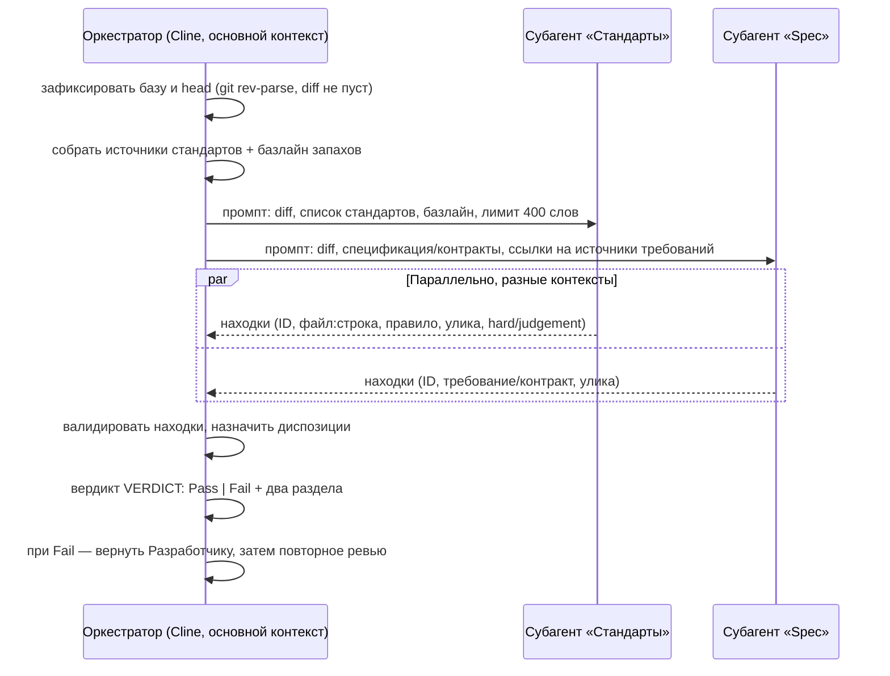
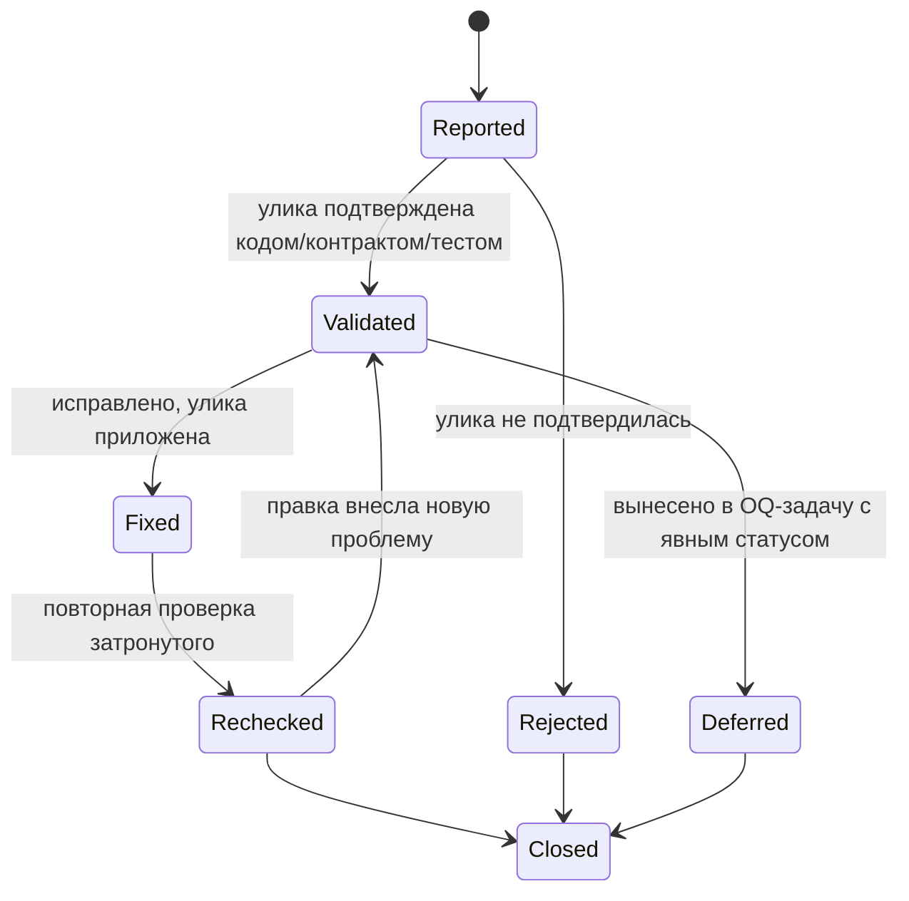

# Design — 001-two-axis-review

Технический подход к двухосевому независимому ревью и жизненному циклу находок.
Настоящий дизайн описывает **процессные** артефакты (Markdown-скиллы и роль), C#-кода не добавляет.

## 1. Проблема текущего ревью

`.agents/reviewer.md` выполняет один проход и возвращает вердикт `Pass`/`Fail`. Из-за этого:

1. **Оси смешиваются.** Нарушение стандарта и недоделанное требование попадают в один список,
   и одна ось маскирует другую: код может идеально соответствовать стилю, но реализовывать не то —
   или делать ровно то, что просили, но ломать конвенции проекта.
2. **Нет идентичности находок.** Нарушения нумеруются внутри одного отчёта (`1..N`), поэтому после
   правок невозможно сказать, какие из них закрыты, какие перенесены, а какие появились новые.
3. **Нет правила сходимости.** Цикл «правки → повторное ревью» может идти бесконечно: у Ревьюера
   нет порога, после которого нужна свежая диагностика подхода, а не ещё один проход.
4. **Нет применимости улик.** Не фиксируется пара «база/head», из-за чего нельзя определить, какие
   прежние проверки остаются валидными после новых коммитов.

## 2. Решение: две независимые оси

| Ось | Вопрос | Источники | Что не делает |
| - | - | - | - |
| **Standards** | Соответствует ли дифф задокументированным стандартам проекта? | `openspec/standards/*`, `.clinerules`, `.editorconfig`, `openspec/schemas/csharp-api.yaml` + базлайн «запахов» Фаулера | Не проверяет полноту требований |
| **Spec** | Реализует ли изменение требования, сохраняя существующее поведение? | `proposal.md`, дельты `specs/`, `contracts/`, `## Sources`, `DECISIONS.md`/`OPEN_QUESTIONS.md` | Не выносит стилевых придирок, которых нет в стандартах |

Оси **никогда не объединяются и не переранжируются**: итог — два отчёта рядом плюс одна строка сводки
(число находок по каждой оси и худшая находка **внутри** каждой оси; «победитель» между осями не выбирается).

## 3. Поток ревью



Каждый субагент стартует с **чистым контекстом** и работает **только на чтение** — ни один из них
не правит код и не видит отчёт другого до собственного вывода.

## 4. Жизненный цикл находки



Правила цикла:

- **ID находки стабилен** внутри предложения (`S-1`, `P-3`: ось + номер) и переиспользуется при повторных проходах.
- **Диспозиция обязательна** для каждой находки: `fixed` (с уликой), `rejected` (с уликой), `deferred` (со ссылкой на `OQ-N`/задачу и явным статусом доставки).
- **Повторное открытие** закрытой находки — только с новой уликой.
- **Применимость улик:** фиксируются `base`, `head` и ревизия стандартов; после новых коммитов заново проверяются только затронутые находки, остальные сохраняют статус по фактически проверенной ревизии.

## 5. Контракт вывода (совместимость с текущим процессом)

Сохраняем прежний контракт, чтобы не ломать `acceptance.md`, DoD 5.5 и архивацию:

```text
VERDICT: Pass        # или Fail — одна из двух строк, первой строкой
## Standards          # отчёт оси стандартов (дословно или слегка вычищенный)
## Spec               # отчёт оси спецификации
## Сводка             # одна строка: находок по осям + худшая внутри каждой
```

Таблица находок расширяет прежний формат `Where / Breaks / Fix`, не заменяя его:

| ID | Where | Breaks | Улика | Класс | Диспозиция |
| - | - | - | - | - | - |
| `P-1` | `src/Api/Foo.cs:42` | Requirement «Bar» | тест падает на пустом входе | hard | fixed |

**Правило блокирующей находки:** вердикт `Fail`, если есть хотя бы одна блокирующая находка по любой оси.
Блокируют: нарушение задокументированного стандарта, невыполненное или частично выполненное требование,
нарушение обязательного правила проекта. Запахи из базлайна и стилевые наблюдения — **не блокируют**.

## 6. Компромиссы и риски

| Решение | Цена | Митигация |
| - | - | - |
| Два субагента на проход | ×2 стоимость и латентность | для малого диффа допустим последовательный запуск — независимость сохраняется |
| Отчёты не объединяются | возможны дубли находок | схлопывание только с явной пометкой «дубль `<ID>`» |
| Лимит отчёта одной оси | потеря деталей | детали остаются адресуемыми: `файл:строка` + строка правила |
| Ревьюер не правит код | несколько итераций правок | правило сходимости (3 цикла) и эскалация владельцу |

## 7. Границы (что НЕ делаем)

- Не заводим внешний issue tracker: артефакты остаются в `openspec/proposals/<id>/`.
- Не копируем прозу референсного набора — заимствуем только структуру и правила.
- Не добавляем NuGet-зависимости и не меняем `.cs`/`.csproj` — изменение целиком документарное.
- Не заменяем DoD: Ревьюер по-прежнему сверяется с `05-definition-of-done.md` §5.1–5.4.

## 8. Трассируемость на стандарты

| Элемент дизайна | Норма |
| - | - |
| Независимое ревью двумя осями | [`constitution.md`](../../../constitution.md) §3.4 (Review gate), [`05-definition-of-done.md`](../../../standards/05-definition-of-done.md) §5.2 |
| ID и диспозиции находок | [`04-documentation.md`](../../../standards/04-documentation.md) §4.7–4.8 (`OQ-N` → `D-NNN`) |
| Правило сходимости и возврат Разработчику | [`.clinerules`](../../../../.clinerules) §3 (делегирование) |
| Фиксация `base`/`head` и применимость улик | [`03-handoffs.md`](../../../standards/03-handoffs.md) (передача контекста) |
| Сохранение `VERDICT: Pass|Fail` | [`000-acceptance.md`](../../000-acceptance.md) («Вердикт ревью») |
