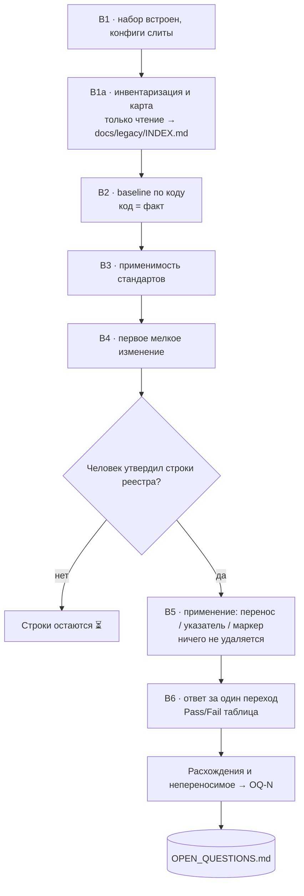

# Design — 006-legacy-docs-alignment

Почему процедура выглядит именно так: сначала только реестр и карта, потом — по утверждению построчно —
указатели и переносы; ничего не удаляется; один источник истины на каждое поведение.

## 1. Проблема

Сценарий B инструкции ([`docs/ADOPTION.md`](../../../../docs/ADOPTION.md) §3) встраивает набор в существующий
проект: B1 переносит набор и вливает конфиги, B2 восстанавливает поведение **по коду**, B3 оценивает
применимость стандартов, B4 запускает первое мелкое изменение. Всё это работает, когда документации нет
или она совпадает с нашей структурой.

Если документация **уже есть и устроена иначе** — свои ADR, ТЗ, wiki/Confluence/Google Docs вне
репозитория, `docs/` с другой иерархией, свой `CHANGELOG.md`, исторические/archived документы,
документы против кода — возникают четыре конкретные проблемы:

| # | Проблема | Наблюдаемое следствие |
| - | - | - |
| P1 | Неизвестен состав документации | Архитектор на B2 восстанавливает по коду то, что уже описано в ТЗ/ADR; реестра «что есть» нет |
| P2 | Два описания одного поведения | Старый документ и наша спека расходятся; ссылаться не на что, доверие к обоим падает |
| P3 | Необратимость | Перенос и удаление чужих документов — решение владельца; без гейта любое «приведение к структуре» рискует стереть историю |
| P4 | Внешняя документация невидима агенту | Wiki/Confluence/Google Docs задают требования, но в репозитории их нет — спецификация «из воздуха» |

Ограничения, заданные владельцем (`OQ-14`, [`docs/SESSION-START.md`](../../../../docs/SESSION-START.md), §5
ADOPTION):

1. **Ничего не удалять и не перемещать без явного утверждения человека.** Отсюда обязательный гейт:
   инвентаризация и карта — только чтение и новый файл; применение — отдельный шаг с утверждением.
2. **Интерфейс — только промпты** для главной сессии (Оркестратора), как R2 в
   [`005-adoption-guide`](../../005-adoption-guide/proposal.md); никаких терминальных команд для человека.
3. **Не переписывать конституцию и не вводить роль** (конституция §7 п. 4): артефакт — реестр, гейт —
   утверждение плана человеком, владелец — Оркестратор; отдельная роль не требуется.

## 2. Решения

| # | Решение | Почему так |
| - | - | - |
| D1 | Реестр — **каталог `docs/legacy/`**: `README.md` (правила, шаблоны маркеров и указателя), `INDEX.md` (реестр `LEG-NNN`), `CHANGELOG-FROZEN.md` (замороженная чужая история) | Симметрично `inputs/` (каталог + `README` + `INDEX`), вмещает шаблоны и приложение, не раздувает один файл; `docs/legacy/` сразу читается как «документация до SDD» |
| D2 | Три отдельных шага: **B1a** — инвентаризация и карта (до B2, только чтение), **B5** — применение (после B4), **B6/проверка** — «ответ за один переход» | Гейт владельца встроен в последовательность: без B1a карта не существует, без утверждения карты B5 не начинается. Разделение «разведка / применение» — то же, что B1 → B2 в существующем сценарии |
| D3 | Единица утверждения — **строка реестра**, а не весь свод | Владелец видит «этот документ → этот артефакт → это действие» и может утвердить 5 строк из 40, отложив остальные; «утвердить всё» необратимо |
| D4 | Перенесённое оставляет **документ-указатель**, а не копию | Указатель не содержит правил, поэтому дубля поведения нет; по старому пути (из закладок и чужой wiki) читатель попадает в наш артефакт, а не в 404 и не в устаревшую копию |
| D5 | **Ничего не удаляется.** Оригинал либо становится указателем, либо остаётся на месте с маркером `🗄 архив` / `🌐 внешний` | Совпадает с правилом `inputs/` ([`04-documentation.md`](../../../standards/04-documentation.md) §4.9: «неактуальное помечается, не удаляется») и снимает необратимость: удаление — отдельное решение владельца, не шаг процедуры |
| D6 | Внешняя документация по умолчанию — **указатель в реестре**; выгружается только то, что задаёт поведение или решение, и не «страницей как есть», а в наш артефакт (`inputs/` как `IN-NNN`, ADR, спека, runbook) | Выгрузка вики целиком создаёт второй источник истины и устаревает в тот же день; нормативный материал должен жить в нашем артефакте, остальное — ссылка с владельцем и причиной |
| D7 | Секреты и персональные данные **не копируются** даже при выгрузке; вместо этого фиксируется причина и владелец | Прямое правило [`04-documentation.md`](../../../standards/04-documentation.md) §4.9 и [`09-security.md`](../../../standards/09-security.md); альтернативы нет |
| D8 | Чужой `CHANGELOG.md` **анализируется**: актуальные записи переносятся в проектный `CHANGELOG.md` как датированная история с указанием источника, остальное — приложением `CHANGELOG-FROZEN.md` за одной строкой-указателем; новые записи — только в проектном | Keep a Changelog + обязательная привязка `(<ID>)` (§4.6) требуют один действующий файл; при этом слепая заморозка теряет для читателя актуальные сведения, а дословное копирование всей истории в проектный файл ломает структуру релизов. Отсюда — разбор с классификацией: актуальное переносится, остальное сохраняется приложением |
| D9 | Код — **фактический источник поведения** (baseline B2 по коду); расхождение «документ vs код» помечает документ устаревшим/замещаемым и выносится в `OQ-N` с рекомендуемым дефолтом | Конституция §1 п. 5 («никаких молчаливых решений»): расхождение — это вопрос владельца, а не повод молча дописать правило в документ или молча поправить код |
| D10 | Маркеры статусов **расширяют** словарь `inputs/INDEX.md` (`⏳ не разобран` · `🔎 в разборе` · `✅ учтён (<NNN-slug>, D-NNN)` · `🗄 архив (не актуален)`) четырьмя значениями реестра документации: `➡ указатель` · `🌐 внешний` · `❓ вопрос (OQ-N)` · `❌ отклонён (D-NNN)` | Ядро словаря общее с `inputs/`, человек не учит второй язык пометок; новые значения нужны только для судьбы документа, которой у входного материала нет. Расширение словаря `inputs/INDEX.md` не требуется |
| D11 | Проверка «ответ за один переход» — **фиксированный список вопросов + промпт + таблица Pass/Fail с числом переходов**, а не «на глаз» | Требование воспроизводимости (конституция §1 п. 4 «Измеряй, не заявляй»): один и тот же список даёт сравнимый результат до и после применения |
| D12 | Работу выполняют **существующие роли**: карту и переносы — `architect` (спецификация, ADR, документы), проверку — `reviewer` (только чтение), применение фиксирует Оркестратор | Новая роль не нужна: артефакт и гейт уже есть у Оркестратора (конституция §7 п. 4) |
| D13 | Процедура живёт **в стандарте документации** (§4.10) + ADOPTION (промпты) + `docs/legacy/` (шаблоны в целевом проекте) | Сейчас документация регламентирована стандартом, а развёртывание — инструкцией; разрывать это на третье место значило бы завести третий источник правил |

### 2.1 Формат реестра `docs/legacy/INDEX.md`

| ID | Документ | Где живёт | Владелец | Потребитель | Актуальность | Наш артефакт | Действие | Статус | Примечание |
| - | - | - | - | - | - | - | - | - | - |
| LEG-001 | `docs/api.md` | репозиторий: `docs/api.md` | <команда/человек> | <команда/роль> | актуален | `openspec/specs/orders/spec.md` | перенос → указатель | `⏳ не разобран` | — |
| LEG-002 | «ADR-7: Outbox» | Confluence, URL | <владелец страницы> | <команда/роль> | актуален | `docs/architecture/adr/007-outbox.md` | выгрузка → ADR | `⏳ не разобран` | нет прав на выгрузку → `OQ-N` |

- `ID` — `LEG-NNN`, сквозной и не переиспользуется (как `IN-NNN` и `OQ-N`).
- `Где живёт` — путь в репозитории **или** URL; для внешнего обязательны владелец и причина в `Примечании`.
- `Владелец` — кто отвечает за документ; `Потребитель` — кто им пользуется (команда, роль, внешний адресат).
- `Актуальность` — `актуален` / `устарел` / `исторический` / `противоречит коду` / `неизвестно`.
- `Наш артефакт` — путь нашего артефакта либо явно «нет соответствия».
- `Действие` — одно из: `перенос` · `перенос → указатель` · `выгрузка → <наш артефакт>` ·
  `оставить + маркер` · `указатель` · `внешний указатель` · `вопрос (OQ-N)` · `отклонить (D-NNN)`.
- `Статус` — словарь D10.

### 2.2 Шаблон документа-указателя

```markdown
# <Название документа> — перенесено

> **Статус:** ➡ указатель · **Перенесено в:** [`<наш артефакт>`](<относительная ссылка>) ·
> **Предложение:** `openspec/proposals/<NNN-slug>/` · **Дата:** <YYYY-MM-DD>

Правил поведения этот файл не содержит: единственный источник — артефакт по ссылке выше.
Историю документа см. в реестре `docs/legacy/INDEX.md` (запись LEG-NNN).
```

Три обязательных свойства указателя, которые проверяет R6: (1) статус-маркер, (2) рабочая ссылка на наш
артефакт, (3) **нет нормативного текста** (правил, требований, схем поведения).

### 2.3 Маркировка «оставить на месте»

Документ, который остаётся (архив, внешняя вики, материал без соответствия), получает в первых строках
маркер-блок:

```markdown
> 🗄 **Архив (не актуален).** Оставлен как история проекта; не является источником истины.
> Актуальное описание: [`<наш артефакт>`](<ссылка>). Реестр: `docs/legacy/INDEX.md` (запись LEG-NNN).
```

Для внешней документации маркер ставится в реестре (`🌐 внешний`) — править чужую страницу процедура
не имеет права.

## 3. Что отклонено

| Вариант | Почему отклонён |
| - | - |
| **Один промпт «приведи всю документацию к нашей структуре»** | Скрывает гейт: инвентаризация и применение сливаются, человек теряет контроль над необратимыми действиями; прямо против ограничения «ничего не перемещать без утверждения» |
| **Перенести всё и переписать чужую иерархию** | Разрушительно: ломает ссылки, закладки и привычки команды; часть документов — история, а не требования |
| **Удалять оригиналы после переноса** | Необратимо и противоречит §4.9; указатель дешевле удаления и сохраняет путь для старых ссылок |
| **Копировать документ в наш артефакт, оставив оригинал как есть** | Прямое нарушение «источник истины один»: две копии разъедутся на первом же изменении |
| **Выгрузить вики/Confluence целиком в `docs/`** | Даёт второй источник истины и устаревает мгновенно; нормативный материал надо разобрать в наши артефакты, остальное — ссылка |
| **Вести реестр в Confluence/Google Docs** | Агент его не видит (вне воркспейса), значит реестр перестаёт быть входом для спецификации; реестр — в репозитории, ссылки наружу — в реестре |
| **Один файл `docs/LEGACY-DOCS.md` вместо каталога** | Возможно для малого проекта; отклонено как база: некуда положить шаблон указателя, маркеры и замороженный changelog, а длинный реестр в одном файле тяжело диффить (см. `OQ-15` — вернуться, если реестр останется < ~20 строк) |
| **Отдельная роль (пресет) `docs-migrator`** | Роль без собственного артефакта и гейта не допускается (конституция §7 п. 4); артефакт (реестр) и гейт (утверждение) уже принадлежат Оркестратору |
| **Скрипт/CI-проверка реестра с первого дня** | Проверять нечего, пока реестра нет; сначала чек-лист и промпт (R6), скрипт — при росте реестра (`OQ-20`) |
| **Сливать все старые записи чужого changelog в проектный без разбора** | Переписывает историю и даты, создаёт дубли и ломает привязку `(<ID>)`; разбор с классификацией сохраняет историю, оставляет один действующий файл и не теряет актуальные сведения |

## 4. Риски и митигации

| Риск | Митигация |
| - | - |
| Реестр сам становится вторым источником истины (в нём начнут писать правила) | В шаблоне `README.md` явно: реестр хранит **метаданные** (где, чей, актуален ли, куда переносится), не содержание; проверка R6 ловит нормативный текст в указателях |
| Промпт B1a начинает «заодно» править документы | Промпт ограничен: создаётся/дополняется только `docs/legacy/INDEX.md`; любой перенос/переименование — стоп и отчёт. Проверяется диффом: в B1a меняется ровно один путь |
| Потеря владельца и контекста при переносе | В реестре обязательны `Владелец` и `Примечание`; в указателе — ссылка на `LEG-NNN`, так что история восстанавливается |
| Указатель со «сводкой правил» вместо ссылки | Шаблон указателя фиксирован; R6 сценарий 2 машинно проверяет, что в указателе нет нормативного текста |
| Секреты и PII попадают в репозиторий при выгрузке вики | D7 + правило §4.9; при отсутствии прав/признаках секретов — строка реестра `🌐 внешний` + `OQ-N`, копирования нет |
| Незамеченный дубль поведения | Действие `перенос` требует проверки «нет второго документа на то же поведение»; при дубле строка останавливается (R2 сценарий 2) |
| Расхождение «документ vs код» решается молча | D9: код — факт, документ помечается, расхождение — `OQ-N`; конституция §1 п. 5 |
| ADOPTION и стандарт разъедутся (два описания процедуры) | Стандарт §4.10 — нормы и формат; ADOPTION — только готовые промпты и место в сценарии B; шаблоны живут в `docs/legacy/` и дублируются в целевом проекте из набора |
| Инвентаризация «на 200 документов» останавливает проект | Реестр пополняется партиями (B1a можно повторять), «неизвестно» — допустимое значение `Актуальность`; применение не блокирует B2–B4, потому что B1a стоит до B2, а B5 — после B4 |
| Чужой changelog продолжают вести параллельно | В `CHANGELOG.md` строка-указатель «история до DD.MM.YYYY — в приложении»; правило §4.10 запрещает новые записи вне проектного файла |

## 5. Трассируемость

### 5.1 Подвопросы `OQ-14` → требования

| Подвопрос `OQ-14` | Требование | Где раскрыт |
| - | - | - |
| Инвентаризация: какие документы есть, где живут, кто ими пользуется, что устарело | **R1** | §2.1 (формат реестра: колонки «Владелец» и «Потребитель», `Актуальность`), `docs/legacy/README.md` + `INDEX.md` |
| Карта соответствий «их документ → наш артефакт» (ADR → `docs/architecture/adr/`, ТЗ → `inputs/` + `IN-NNN` + спека, changelog → `CHANGELOG.md`, wiki → выгрузка/указатель, runbook/SLO → `docs/operations/`) | **R1**, **R2** | §2.1 колонка «Наш артефакт», таблица соответствий ниже |
| Правило «источник истины один» | **R2** | §2.2 (указатель без правил), §3 (отклонённые варианты) |
| Что переносить / оставить со ссылкой / пометить устаревшим | **R4**, **R2** | §2.2–2.3 (указатель и маркер), §4.9 стандарта; сценарий R4 «документ замещён без противоречия коду» |
| Документация вне репозитория (wiki/Confluence/Google Docs) | **R3** | D6, D7, §3 |
| Проверка «новый участник находит ответ за один переход» | **R6** | §6.3 (промпт), чек-лист вопросов |
| Исторические (archived) документы и чужой `CHANGELOG.md` | **R4** | D5, D8, §2.3 |
| Документы, противоречащие коду | **R5** | D9 |

### 5.2 Карта соответствий (базовая таблица, которую уточняет реестр)

| Их документ | Наш артефакт | Действие по умолчанию |
| - | - | - |
| ADR (свои) | `docs/architecture/adr/<NNN>-<slug>.md` | перенос с сохранением номера и статуса; указатель |
| ТЗ / постановка | `inputs/briefs/IN-NNN-<slug>.<ext>` + `inputs/INDEX.md` + спека в `openspec/specs/` | перенос (оригинал не правится) → `IN-NNN` → `## Sources` предложения |
| `docs/` с другой иерархией | `docs/architecture/`, `docs/operations/`, `inputs/` | перенос по смыслу; пустые/исторические — маркер архива |
| Свой `CHANGELOG.md` | актуальные записи → проектный `CHANGELOG.md` (с `LEG-NNN`); остальное → `CHANGELOG-FROZEN.md` + строка-указатель | анализ и выборка (D8) |
| Wiki / Confluence / Google Docs | указатель в реестре; нормативное — в наш артефакт | указатель по умолчанию (D6) |
| Runbook / SLO | `docs/operations/` (`slo.md`, `capacity.md`, `runbooks/`) | перенос; указатель |
| Схемы, OpenAPI, proto | `contracts/` предложения → `openspec/specs/` | перенос; расхождение с кодом → `OQ-N` |
| Презентации, заметки, маркетинг | `inputs/concepts/` | перенос, если задают требования; иначе маркер архива |
| Архив (историческое) | остаётся на месте + `🗄` + строка реестра | не удаляется (D5) |

### 5.3 Нормы, на которые опирается процедура

| Элемент | Норма |
| - | - |
| Ничего не удаляется, неактуальное помечается | [`04-documentation.md`](../../../standards/04-documentation.md) §4.9; `inputs/README.md` п. 4 |
| Один источник истины, трассируемость | [`constitution.md`](../../../constitution.md) §1 п. 3 |
| Расхождение не решается молча | [`constitution.md`](../../../constitution.md) §1 п. 5; `OQ-N` — §4.7 |
| Гейт применения — утверждение человека | [`constitution.md`](../../../constitution.md) §1 п. 2, §3 п. 1 |
| Роль не вводится без артефакта и гейта | [`constitution.md`](../../../constitution.md) §7 п. 4 |
| Changelog: один файл, привязка `(<ID>)`, SemVer | [`04-documentation.md`](../../../standards/04-documentation.md) §4.6 |
| DoD: спека с проверяемыми сценариями; релиз с changelog | [`05-definition-of-done.md`](../../../standards/05-definition-of-done.md) §5.1, §5.4 |
| Только промпты, адресат — Оркестратор | [`005-adoption-guide`](../../005-adoption-guide/proposal.md) R2; [`docs/ADOPTION.md`](../../../../docs/ADOPTION.md) §0 |

## 6. Черновики промптов (перенос в `docs/ADOPTION.md` — задачи 2.1–2.3)

> Черновики ниже — **готовые к копированию** блоки. Их перенос в
> [`docs/ADOPTION.md`](../../../../docs/ADOPTION.md) и правка §0/§5/§7 — отдельные задачи `tasks.md`
> (2.1–2.3): на этом шаге сам ADOPTION не меняется. Адресат — главная сессия (Оркестратор), поэтому
> каждая первая строка — «Ты — Оркестратор SDD этого проекта», а терминальных команд для человека нет.

### 6.1 Промпт B1a — инвентаризация и карта (только чтение, до B2)

Куда встраивается: **между B1 и B2** в [`docs/ADOPTION.md`](../../../../docs/ADOPTION.md) §3. До B1a
документация проекта не описана, и B2 восстанавливает «по коду» вслепую; после B1a у Архитектора есть
карта, что уже описано, а что — нет.

```text
Ты — Оркестратор SDD этого проекта.
У проекта уже есть своя документация, и её структура отличается от нашей. Сейчас — только разведка:
ничего не перемещай, не переименовывай, не переписывай и не удаляй.

1) Собери состав документации: docs/ и вложенные каталоги, *.md в корне, README-файлы модулей,
   каталоги wiki/, adr/, design/, specs/, runbook/, changelog/; отдельно — упоминания внешней
   документации (Confluence, Google Docs, вики-хост) в README, AGENTS.md, ссылках и комментариях к коду.
2) Создай docs/legacy/README.md (правила ведения, статусы, шаблон строки реестра и шаблон
   документа-указателя — по образцу inputs/README.md и inputs/INDEX.md) и docs/legacy/INDEX.md.
3) Занеси в реестр каждую найденную единицу документации: ID LEG-NNN (сквозной, не переиспользуется),
   документ, где живёт (путь в репозитории или URL), владелец, потребитель (кто документом пользуется),
   актуальность (актуален / устарел / исторический / противоречит коду / неизвестно), наш артефакт
   (путь либо «нет соответствия»), действие (перенос / перенос → указатель / выгрузка → наш артефакт /
   оставить + маркер / указатель / внешний указатель / вопрос / отклонить), статус и примечание.
4) Отдельно выдели: документы вне репозитория; документы, которые задают требования (ТЗ, постановки,
   ADR, схемы, SLO); исторические и archived; документы, которые заведомо расходятся с кодом
   (проверь по коду и README, но ничего не исправляй).
5) Для каждой строки укажи, соответствует ли она нашему артефакту и что нужно сделать; где данных
   нет (владелец, актуальность, URL) — ставь «неизвестно» и перечисли эти строки отдельно.
6) Найди дубли: места, где одно и то же поведение описано в двух и более документах. Ничего не своди —
   только перечисли с адресами.

Верни отчёт: сколько единиц документации найдено, сколько внешних, сколько противоречит коду,
сколько дублей, какие строки требуют моего ответа, и однострочную рекомендацию — какие строки
утвердить первыми. Ничего, кроме docs/legacy/, не меняй.
```

### 6.2 Промпт B5 — применение: привести документацию к нашей структуре (после B4)

Куда встраивается: **после B4** в [`docs/ADOPTION.md`](../../../../docs/ADOPTION.md) §3 — когда процесс уже
развёрнут, baseline по коду утверждён, первое изменение прошло, и понятно, куда переносить. Гейт:
применяются только утверждённые человеком строки реестра.

```text
Ты — Оркестратор SDD этого проекта.
Приведи документацию проекта к нашей структуре по утверждённому реестру docs/legacy/INDEX.md.

Правила, обязательные к соблюдению:
1) Применяй ТОЛЬКО те строки реестра, которые я подтвердил в этом сообщении или раньше словами
   «утверждаю LEG-NNN». Остальные не трогай — ни переносом, ни правкой.
2) Ничего не удаляй. Перенесённый документ превращается в документ-указатель по шаблону из
   docs/legacy/README.md: статус-маркер, ссылка на наш артефакт, номер LEG-NNN — и без правил поведения.
3) Документ, который остаётся на месте (архив, внешняя страница, материал без соответствия), получает
   маркер: архив — в первых строках документа, внешний — строкой в реестре.
4) Источник истины один. Если после переноса поведение описано в двух местах — останови эту строку,
   доложи о дубле и предложи, какое описание оставить. Две копии правил не оставляй.
5) Документ, противоречащий коду: код — фактическое поведение. Помечай документ устаревшим или
   замещаемым и вынеси расхождение в OPEN_QUESTIONS.md как OQ-N с рекомендуемым значением по умолчанию.
   Поведение не меняй и правило в документ не дописывай.
6) Свой CHANGELOG.md проекта: проанализируй записи, а не копируй вслепую. Актуальное (действующие
   версии, значимые изменения, на которые ссылаются) перенеси в проектный CHANGELOG.md как датированную
   историю с указанием источника (LEG-NNN); остальное перенеси дословно — без правки формулировок и
   дат — в docs/legacy/CHANGELOG-FROZEN.md. В проектном CHANGELOG.md оставь одну строку-указатель на
   приложение. Ничего не теряй: каждая запись старого файла должна быть доступна. Новые записи — только
   в проектном CHANGELOG.md с привязкой (<ID>).
7) Документацию вне репозитория не правь. Выгружай только то, что задаёт поведение или решение:
   ТЗ — в inputs/ как IN-NNN с записью в inputs/INDEX.md, ADR — в docs/architecture/adr/,
   эксплуатацию — в docs/operations/. Остальное — строка реестра со ссылкой, владельцем и причиной.
   Секреты, ключи и персональные данные не копируй ни при каких условиях.
8) Не трогай исходный код, тесты, конфигурацию сборки и CI. Кода не пиши.

Работай партиями по 5–10 утверждённых строк. После каждой партии — короткий отчёт: что перенесено,
какие указатели и маркеры поставлены, какие строки остановлены и почему, какие вопросы OQ-N заведены.
Верни итог: обновлённый реестр (статусы), список наших артефактов, список неперенесённого с причиной
и что осталось за мной.
```

### 6.3 Промпт B6 — проверка «новый участник находит ответ за один переход»

Куда встраивается: **после B5** и в §7 ADOPTION (проверка развёртывания) — как отдельная проверка
документации; тот же промпт годится как повторяемая проверка после крупных переносов.

```text
Ты — Оркестратор SDD этого проекта.
Проверь, что новый участник находит ответ по документации за один переход от точек входа
(README.md, AGENTS.md, docs/legacy/INDEX.md). Ничего не исправляй — только проверяй.

Задай по репозиторию ровно эти десять вопросов и для каждого покажи путь до ответа:
1) что это за продукт и для кого;
2) как его собрать и запустить;
3) какую версию сейчас эксплуатируем и что в ней изменилось;
4) какие у продукта публичные контракты;
5) какие архитектурные решения приняты и почему;
6) где описаны SLO, ёмкость и runbook;
7) какие требования заказчика действуют и где они зарегистрированы;
8) какие вопросы открыты и какие решения приняты;
9) какие стандарты обязательны и где исключения;
10) как внести изменение по процессу (от идеи до релиза).

Правила подсчёта: переход — это ссылка, по которой надо пройти, чтобы получить ответ.
Ответ из точки входа — 0 переходов; из документа, на который точка входа ссылается напрямую, —
1 переход. Ответ, найденный только поиском или только в памяти агента, — Fail.
Для каждого вопроса: Pass (≤ 1 перехода) или Fail (> 1 перехода либо ответа нет), число переходов,
путь и что мешает.

Отдельно проверь машинно:
— все ссылки в docs/legacy/INDEX.md резолвятся;
— у каждой строки реестра есть наш артефакт либо явное действие;
— архивные документы помечены, документы-указатели соответствуют шаблону и не содержат правил.

Верни таблицу «вопрос → Pass/Fail → переходы → путь» и одну строку итога. Ничего не правь.
```

### 6.4 Как это стыкуется с §3 ADOPTION и с оговоркой «Пока не покрыто»

- **Место в сценарии B.** Порядок становится: B1 (копирование и слияние конфигов) → **B1a**
  (инвентаризация и карта, только чтение) → B2 (baseline по коду) → B3 (применимость стандартов) →
  B4 (первое изменение) → **B5** (применение по утверждённым строкам) → **B6** (проверка «ответ за один
  переход»). B1a не блокирует B2–B4: реестр можно вести партиями, а baseline всё равно строится по коду
  (D9). B5 без утверждённых строк не запускается — это гейт человека.
- **Оговорка «Пока не покрыто»** в §3 ADOPTION **удаляется** и заменяется разделом «чужая документация»:
  что теперь покрыто (реестр, карта, указатели, маркеры, разбор чужого changelog, внешние документы,
  расхождения с кодом, проверка), что осталось за владельцем (утверждение строк, удаление — только его
  решение) и какие подвопросы ушли в `OPEN_QUESTIONS.md` (`OQ-15`…`OQ-20`).
- **§0 «Кому адресованы промпты»** дополняется строками B1a и B5 (исполнитель — Оркестратор, при
  применении — `architect`), **§5** — строкой «утвердить план приведения документации к нашей структуре»
  в списке человеческих действий, **§7** — промптом B6, **§9** — ссылкой на `docs/legacy/`.
- **Одно ограничение 005 сохраняется дословно:** интерфейс — только промпты; ручных файловых операций
  процедура не добавляет (реестр создаёт сессия; человек только утверждает строки).

## 7. Последовательность работ

1. Утверждение предложения человеком (`Status: Approved`) — гейт спецификации.
2. Шаблоны `docs/legacy/` (README + INDEX + CHANGELOG-FROZEN) как часть набора.
3. Стандарт §4.10 и правки ADOPTION (промпты B1a/B5/B6, снятие оговорки, §0/§5/§7/§9).
4. Карты репозитория (`AGENTS.md` + `.clinerules`, `README.md`, `openspec/project.md`,
   `docs/SESSION-START.md`) и запись в `CHANGELOG.md`.
5. Закрытие `OQ-14` → `DECISIONS.md`, регистрация `OQ-15`…`OQ-20` в `OPEN_QUESTIONS.md`.
6. Прогон процедуры на первом реальном проекте с чужой документацией; уточнения — в раздел
   «Уточнения после приёмки» [`acceptance.md`](./acceptance.md).

## 8. Диаграмма решения


